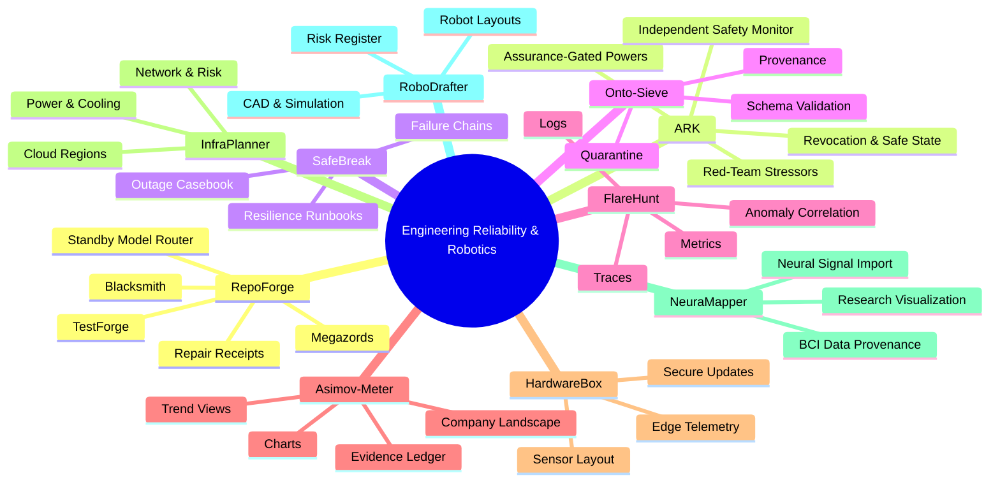
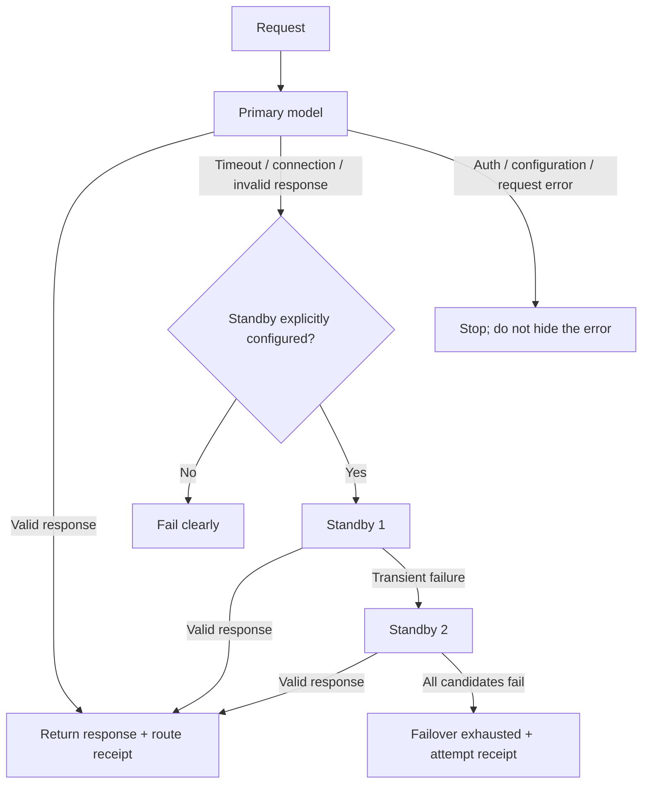
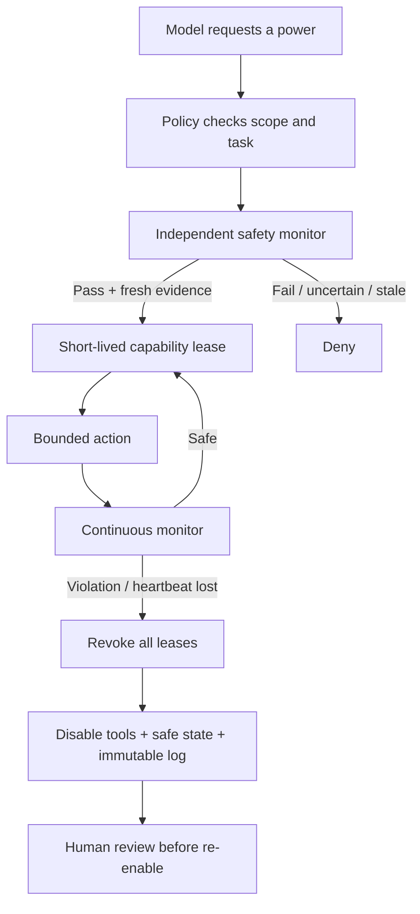
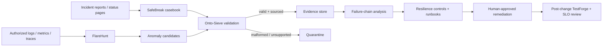
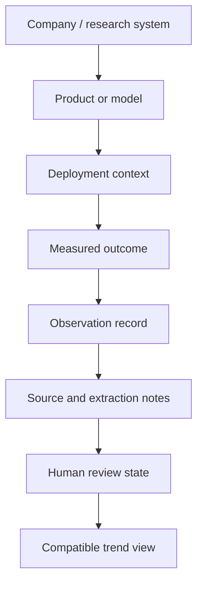
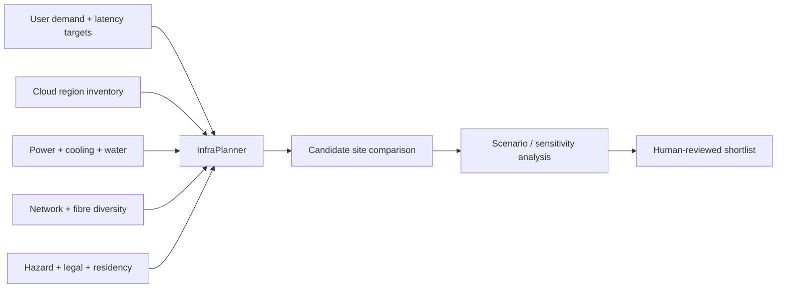
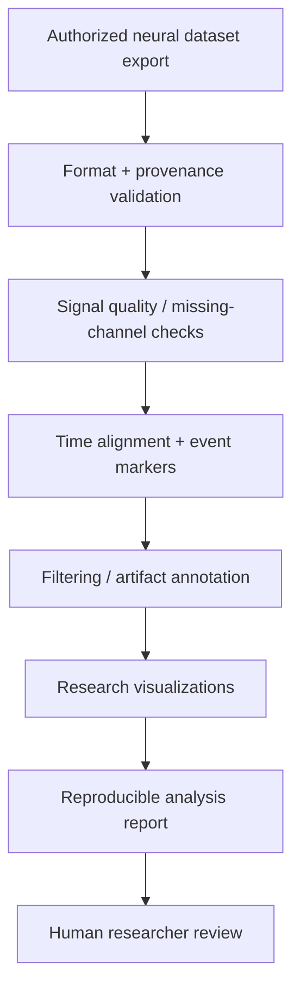

# Platform Blueprint — Reliability, Alignment, Robotics & Infrastructure

**Status:** active design and implementation branch  
**Repository:** RepoForge  
**Branch:** `feat/resilience-robotics-blueprint`  
**Date:** 2026-11-17

This is the single architecture reference for the next group of projects. It consolidates the product ideas before we split them into more repositories. The JSON files under `configs/` are the machine-readable starter contracts. A configuration file is not proof that the corresponding runtime is already implemented.

## 1. The system map

The aim is a set of interoperable tools, not one giant autonomous agent with unrestricted access.



### Product ownership

| Project/module | Primary job | Initial home |
|---|---|---|
| RepoForge standby router | Keep generation available through explicitly approved provider fallbacks | RepoForge |
| ARK powers | Grant and revoke bounded agent capabilities under independent safety controls | ARK |
| SafeBreak | Turn verified service incidents into reusable resilience lessons and runbooks | RepoForge reliability package |
| Onto-Sieve | Validate structured evidence and quarantine malformed or unsupported claims | Onto-Sieve |
| FlareHunt | Find anomalies in telemetry the operator is authorized to provide | RepoForge reliability package |
| Asimov-Meter | Evidence-first impact ledger and honest visual summaries | Asimov-Meter |
| HardwareBox | Local edge telemetry appliance for lab, robot and infrastructure instrumentation | Hardware blueprint first |
| InfraPlanner | Compare published cloud regions and candidate data-centre sites | RepoForge planning package |
| NeuraMapper | Privacy-preserving analysis and visualization of authorized neural/BCI datasets | NeuraMapper concept |
| RoboDrafter | Parametric robot concept, layout and simulation workflow | RoboDrafter concept |

Do not create a new repository for each idea yet. Prove the contracts and workflows first; split a module out only when it has code, tests, a stable interface and a distinct maintainer purpose.

---

## 2. RepoForge — standby AI models

### Desired behavior

A primary model is selected deliberately. Standby models are listed explicitly and used only after a classified transient failure. The system must never silently switch to an unknown provider, return mock output as if it were real, or hide an authentication/configuration error.



### Implemented in this branch

- `src/repoforge/providers/failover.py` adds `StandbyProviderPool`.
- The primary and standby sequence is explicit.
- Connection errors, timeouts and unusable responses can trigger a standby.
- Rate-limit/quota fallback is disabled by default because it can create a second bill; it requires explicit opt-in.
- Authentication, provider configuration and request errors stop the route.
- `GenerationResult` returns the chosen provider/model and redacted attempt metadata. Prompts, credentials and provider response bodies are not copied into the attempt receipt.
- No implicit mock fallback is permitted.
- CLI supports repeated `--standby` options.

Example:

```bash
repoforge generate "Review this patch" \
  --provider deepseek \
  --standby openai \
  --standby groq
```

### Still required before production-grade failover

- Load the JSON route file directly from CLI (the config is present, but config-file loading is not yet wired).
- Add health/circuit-breaker state with bounded cooldowns; current fallback occurs at request time and does not run background health checks.
- Enforce per-task token/cost budgets and a maximum paid fallback count.
- Check data residency, retention, model capability and provider terms before routing sensitive prompts.
- Add cross-provider semantic regression tests: same task, rubric, format and quality threshold. A backup that responds is not automatically an equivalent backup.
- Add operator-visible route telemetry and a manual disable switch.

Configuration seed: [`configs/model_failover.json`](../configs/model_failover.json)

---

## 3. ARK — powers for aligned models, with revocation

We can build powerful *simulation capabilities* for agents, but we cannot honestly promise a literal zero probability of rogue behavior. Alignment scores, policy checks and monitors do not prove that a model can never fail.

The engineering target is **fail-closed capability control and small blast radius**:

1. Models do not issue or renew their own power grants.
2. An independent monitor evaluates proposals and safety signals.
3. Every capability is scoped, least-privilege and time-limited.
4. Stale telemetry, monitor disagreement, unauthorized actions, goal substitution or reward-hacking signals revoke the lease.
5. A separate safety controller disables tools and moves the system to a defined safe state.
6. Restart requires a fresh check and human authorization.



### Power-up concepts

| Power | Simulation benefit | Restriction |
|---|---|---|
| Scout | Ground-truth observation for a clearly labeled privileged-information experiment | Never silently enable for ordinary agents; benchmark results must label the advantage |
| Shield | One hazard interception in a controlled episode | Does not replace the independent safety monitor |
| Boost | Extra simulation steps | Cannot increase real actuator force, speed or authority |
| Team Link | Share approved summaries across squad members | No hidden-state or private-memory sharing |
| Recovery | Reset to a safe checkpoint | Cannot erase audit history or rewrite the task objective |

### Red-team stress moves

Use these only as controlled adversarial evaluations against a sandboxed model: prompt injection, reward hacking, false-goal substitution, corrupted memory, sensor spoofing, tool misuse, conflicting objectives, and multi-agent collusion. The purpose is to discover failure modes and test the revocation path—not to deploy offensive capabilities.

Configuration seed: [`configs/ark_powerup_policy.json`](../configs/ark_powerup_policy.json)

**Current truth:** ARK already has research agents, power-ups, a SafetyMonitor and a threat meter. The configuration above is a proposed capability-lease contract; it is not yet an implemented cryptographic authorization service. ARK's threat meter is an experimental signal, not a calibrated probability of real-world catastrophe.

---

## 4. SafeBreak + Onto-Sieve + FlareHunt

These three components should form one incident-learning loop.



### SafeBreak — what it stores

- Provider, product/service, incident window and affected region/scope.
- Observed symptoms and customer-facing impact.
- Root cause versus contributing conditions (kept separate).
- Detection, mitigation, restoration and backlog-drain timeline.
- Evidence URL, publication date, attribution and confidence/status.
- Unknown fields remain unknown; the system must not invent affected-user counts, duration or root cause.

### Outlook / Microsoft 365 case

The recent incident was **12–14 November 2026**, not an outage that began on 16 November. The more detailed reporting appeared on **16 November**. Reporting describes a combination of a latent software defect dating to July, a failed Teams networking gateway, and an unrelated condition that left more than 14% of server capacity unavailable. The remaining gateway infrastructure was then overloaded. Microsoft said there was no indication of malicious activity; the final vendor post-incident report was still pending in the sources reviewed.

Sources:
- [The Guardian — Microsoft identifies months-old bug as a root cause of global outage (16 Nov 2026)](https://www.theguardian.com/technology/2026/nov/16/microsoft-global-outage-cause)
- [UK Parliament — Microsoft 365 outage oral statement (16 Nov 2026)](https://commonsbusiness.parliament.uk/Document/109053/Pdf?subType=Standard)

The starter evidence record is [`configs/safebreak_incidents.json`](../configs/safebreak_incidents.json). It is intentionally marked as reported evidence, not a completed forensic postmortem.

### Techniques SafeBreak should recommend

| Failure pattern | Resilience technique |
|---|---|
| One gateway or region becomes unavailable | Failure-domain isolation, multi-zone routing, tested regional failover |
| Remaining capacity is overwhelmed | Reserve capacity, load shedding, bounded queues, backpressure |
| Retries amplify the outage | Exponential backoff, jitter, retry budgets, idempotency |
| A latent bug appears after a change | Canary deployments, staged rollout, feature flags, change correlation |
| Rollback cannot reverse the fault | Versioned configuration, reversible migrations, tested rollback and restore |
| Recovery creates a second traffic spike | Rate-controlled backlog draining and recovery load tests |
| Health checks give false confidence | Independent synthetic checks, dependency-aware probes, quorum/heartbeat logic |
| Users lose the main communication channel | Independent status page, customer communications and offline procedures |

### Onto-Sieve — evidence gate

Validate required fields, types, dates, provider/product identifiers, source links, attribution and provenance. Quarantine invalid records instead of silently dropping or rewriting them. A human must approve a corrected record before release. Do not treat a reachable URL as proof that a claim is true.

**Repository status:** Onto-Sieve currently has a README only; no parser, validator, quarantine store or tests were present in the inspected default branch. Its first runnable milestone should be a small JSON/RDF validation library, not an ambitious autonomous knowledge graph.

### FlareHunt — telemetry hunter

Start with *user-provided or explicitly connected telemetry*, not internet-wide probing. Detect:
- sudden changes in 5xx/timeout rates;
- p95/p99 latency and queue-depth growth;
- saturation of CPU, memory, disk, connection pools and worker queues;
- error bursts correlated with releases/configuration changes;
- health-check disagreement across regions;
- dependency failures and retry storms;
- unusual authentication failures or unexpected outbound traffic.

For each alert, return the evidence window, baseline, detection rule, confidence and likely dependencies. Do not claim root cause from correlation alone. The operator authorizes any remediation.

---

## 5. Asimov-Meter — mind maps, charts and graphs

Asimov-Meter is currently an **evidence-first numeric ledger**. Its current CLI supports add/list/report/CSV export; it does not yet contain a dashboard or automatic web collection. Do not turn it into a universal "AI goodness" score.

### Visualization design

- **Mind map:** companies → products/services → sectors → deployment contexts → evidence records.
- **Trend chart:** only compatible observations sharing system, indicator, unit, population and method.
- **Benefit/harm chart:** show separate counts and distributions; do not collapse unlike measures.
- **Evidence graph:** source → extracted observation → reviewer → validation state.
- **Coverage chart:** show sectors/products with missing evidence as *unknown*, not zero.



The product catalogue is [`configs/ai_robotics_landscape.json`](../configs/ai_robotics_landscape.json). It records companies and public product/service pages, not independent assessments or comparative rankings.

### Companies and product examples

| Company | Public product/service examples | What the catalogue should track |
|---|---|---|
| OpenAI | GPT-6 family, Responses API, Agents SDK | model/API lifecycle, status, supported capabilities |
| Anthropic | Claude Fable 5.2, Claude Platform API, Claude Code | model/API lifecycle, deprecations and availability |
| Google DeepMind | Gemini Robotics 2.5, Gemini Robotics ER 2, On-Device 2 | VLA/embodied reasoning, partner deployments and evaluation claims |
| NVIDIA | Isaac GR00T, Jetson Thor, robotics simulation workflows | foundation models, compute, simulation and deployment stack |
| Boston Dynamics | Atlas, Orbit | industrial humanoid and fleet/enterprise software |
| Figure | Figure 03, Helix | humanoid hardware and VLA software |
| 1X | NEO | home robotics hardware and AI model |
| Neuralink | N1 implant and BCI clinical-trial programme | investigational BCI functionality and trial evidence |

Official starting points: [OpenAI API](https://developers.openai.com/api/docs), [Anthropic Claude Fable](https://www.anthropic.com/claude/fable), [Gemini Robotics](https://deepmind.google/models/gemini-robotics/), [NVIDIA Isaac GR00T](https://developer.nvidia.com/isaac/gr00t), [Boston Dynamics Atlas](https://bostondynamics.com/products/atlas), [Figure 03](https://www.figure.ai/figure), [1X NEO](https://www.1x.tech/discover/neo-home-robot), [Neuralink trials](https://neuralink.com/trials/).

Neuralink's public trial page describes investigational work involving hands-free computer/robotic-arm control and communication support for particular clinical populations. Do not infer efficacy beyond trial evidence or claim NeuraMapper can connect to Neuralink's implant/API.

---

## 6. InfraPlanner — data-centre and cloud-region planner

### Published footprint data

[`configs/datacenter_regions.json`](../configs/datacenter_regions.json) contains a starter inventory of public cloud regions and Local Zones in India:

| Provider | Published region / locality | Region ID |
|---|---|---|
| AWS | Mumbai | `ap-south-1` |
| AWS | Hyderabad | `ap-south-2` |
| AWS Local Zone | Delhi | `ap-south-1-del-1a` |
| AWS Local Zone | Kolkata | `ap-south-1-ccu-1a` |
| Google Cloud | Mumbai | `asia-south1` |
| Google Cloud | Delhi | `asia-south2` |
| Azure | Pune (Central India) | `centralindia` |
| Azure | Hyderabad (India South Central) | `indiasouthcentral` |
| Azure | Chennai (South India) | `southindia` |
| Azure | Mumbai (West India) | `westindia` |

Official data sources: [AWS India infrastructure](https://aws.amazon.com/local/india/), [AWS Local Zone locations](https://aws.amazon.com/about-aws/global-infrastructure/localzones/locations/), [Google Cloud locations](https://cloud.google.com/about/locations/), [Google Cloud regional zones](https://docs.cloud.google.com/filestore/docs/regions), [Azure region list](https://learn.microsoft.com/en-us/azure/reliability/regions-list).

**Important location boundary:** these are vendor-published regions/Local Zones and city-level descriptions, not verified addresses or coordinates of individual data-centre buildings. Provider facilities are often not publicly disclosed at building level. The initial map must render region/city-level markers with that precision label; never invent facility pins.

### Site selection scoring inputs

1. Power availability, grid reliability, price, renewable mix and future capacity.
2. Cooling feasibility, climate, water stress and water-use constraints.
3. Diverse fibre routes, internet exchanges, carrier choices and backhaul latency.
4. Flood, seismic, heat, storm, wildfire and other site hazards.
5. Land, permits, construction, tax, workforce and maintenance access.
6. Data residency, sovereignty, customer location and service availability.
7. Physical security, supply chain and disaster-recovery separation.

Do not publish a numeric site score until all input weights, sources, timestamps and missing-data handling are explicit. Use a multi-criteria decision report with sensitivity analysis rather than one unexplained winner.



---

## 7. HardwareBox — conceptual edge monitoring appliance

HardwareBox is the physical telemetry companion to Asimov-Meter and the reliability tools. It should start as a **read-only monitoring appliance**, not a robot-control box.

```text
             HARDWARE BOX — CONCEPTUAL BLOCK SKETCH
  +----------------------------------------------------------+
  | Certified isolated power supply + fuse + thermal cutoff |
  |                                                          |
  |  Sensors             Secure MCU / Edge Computer           |
  |  - temperature  ---> - device identity / secure element  |
  |  - humidity     ---> - local encrypted buffer            |
  |  - fan speed    ---> - signed update / rollback          |
  |  - power meter  ---> - validation + timestamp            |
  |  - vibration    ---> - metrics / MQTT over TLS            |
  |  - door/leak    ---> - outbound-only network policy       |
  |                                                          |
  |  Ethernet -> isolated network -> Asimov-Meter / FlareHunt |
  +----------------------------------------------------------+
        No default remote actuation; safe local operation.
```

The machine-readable draft is [`configs/hardware_box_blueprint.json`](../configs/hardware_box_blueprint.json).

Before fabrication, qualified electrical/mechanical engineers must choose actual parts and ratings, perform thermal/EMC/power validation, and review enclosure, grounding, fusing, battery and regulatory requirements. The current file is not a schematic or build-ready electrical design.

---

## 8. NeuraMapper — how it could help BCI research

NeuraMapper is a research-data analysis and visualization workbench, not an implant controller or diagnostic product.

### Proposed pipeline



Potential value to BCI research teams (including teams working with Neuralink-like studies):
- unify experiment metadata, task timestamps, channels and recording sessions;
- visualize signal quality, event timing and task outcomes;
- compare decoding experiments while retaining dataset, participant and method boundaries;
- export reproducible plots and notebooks for approved research review.

Use only data the researcher is authorized to access and export. Do not reverse-engineer implant protocols, bypass device security, infer a person's thoughts from unrelated data, or make clinical claims. Neuralink's public trials describe research around computer/robotic-arm control and communication; they do not imply a public developer API for raw implant data.

---

## 9. RoboDrafter — robot and large-mech drafting

RoboDrafter should turn a written mission into a structured engineering concept:

1. mission and operating environment;
2. load, reach, payload and mobility constraints;
3. rough layout and joint/actuator inventory;
4. center-of-mass and stability checks;
5. power, thermal and duty-cycle budget;
6. CAD export (URDF/SDF plus STEP/STL where toolchains permit);
7. simulation and collision checks;
8. FEA, fatigue, thermal and human-factors validation;
9. hazard log and safe-state design;
10. engineer approval before any fabrication.

```text
ROBO DRAFTER — CONCEPTUAL LARGE-MECH LAYOUT (NOT BUILD INSTRUCTIONS)

              [360° perception mast]
                      ||
             +------------------+
             | protected compute|
             +------------------+
          ___/|                  |\___
         /   shoulder          shoulder \
        /      joint            joint    \
       |       [TORSO / POWER]           |
       |        [BATTERY BAYS]           |
       |                                 |
       |   arm link             arm link |
       |      |                    |     |
       |   tool mount          tool mount|
       |                                 |
       |       pelvis / load frame       |
       +-------------+-------------------+
                    / \
             wide stable base
          [independent safety controller]

  Draft only: dimensions, loads, actuators and materials are unspecified.
```

The initial risk register is [`configs/giant_mech_risk_register.json`](../configs/giant_mech_risk_register.json). The first use cases should be non-weaponized inspection, disaster-area sensing and remote material handling. No autonomous use of force, weapons or crowd-control functions. Large mechs have severe toppling, crush, structural, battery, ground-bearing and control-failure hazards; simulation is not proof of safe construction.

---

## 10. Build order and acceptance gates

| Phase | Deliverable | Acceptance gate |
|---|---|---|
| 1 | RepoForge provider failover | Unit tests for transient, auth, quota, config and exhausted routes; CLI reports chosen provider |
| 2 | Config-driven routing | Strict JSON schema validation; no implicit credentials or spending; per-task budgets |
| 3 | SafeBreak incident schema + Onto-Sieve validator | Invalid records quarantined; source attribution preserved; no fabricated impact numbers |
| 4 | FlareHunt local telemetry MVP | Deterministic fixture tests, anomaly evidence windows, false-positive measurements |
| 5 | ARK power leases | Independent monitor, expiry, revocation, safe state, adversarial regression suite |
| 6 | Asimov-Meter visual layer | Charts only from compatible records; missing values stay missing; exports reproducible |
| 7 | InfraPlanner | Source timestamps, region precision, weighted comparison and sensitivity analysis |
| 8 | HardwareBox / NeuraMapper / RoboDrafter | Simulated or bench-tested prototypes; independent engineering and privacy/safety review |

### Merge rules

- One active feature branch for this work: `feat/resilience-robotics-blueprint`.
- `main` remains the stable source of truth.
- No merge from this branch until CI passes on the exact head commit, review findings are answered, and config JSON parses.
- No branch deletion or repository cleanup in this task.
- Every capability must be labelled **implemented**, **experimental**, or **planned**.
- No claims of "zero rogue probability", "fully fixed", "production ready" or "facility exact location" without evidence.

---

## 11. Source register

Sources last checked on 2026-11-17:

- Microsoft outage cause reporting: [The Guardian, 16 Nov 2026](https://www.theguardian.com/technology/2026/nov/16/microsoft-global-outage-cause); [UK Parliament statement, 16 Nov 2026](https://commonsbusiness.parliament.uk/Document/109053/Pdf?subType=Standard).
- AI product/platform references: [OpenAI API docs](https://developers.openai.com/api/docs); [Anthropic Claude Fable](https://www.anthropic.com/claude/fable); [Google DeepMind Gemini Robotics](https://deepmind.google/models/gemini-robotics/); [NVIDIA Isaac GR00T](https://developer.nvidia.com/isaac/gr00t).
- Robotics hardware/product references: [Boston Dynamics Atlas](https://bostondynamics.com/products/atlas); [Figure 03](https://www.figure.ai/figure); [1X NEO](https://www.1x.tech/discover/neo-home-robot); [Neuralink clinical trials](https://neuralink.com/trials/).
- Cloud footprint references: [AWS India](https://aws.amazon.com/local/india/); [AWS Local Zones](https://aws.amazon.com/about-aws/global-infrastructure/localzones/locations/); [Google Cloud locations](https://cloud.google.com/about/locations/); [Google regional zones](https://docs.cloud.google.com/filestore/docs/regions); [Azure regions](https://learn.microsoft.com/en-us/azure/reliability/regions-list).
